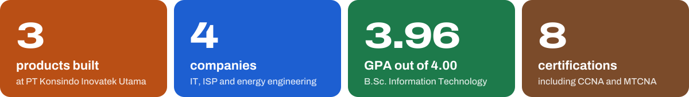
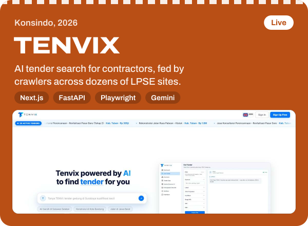
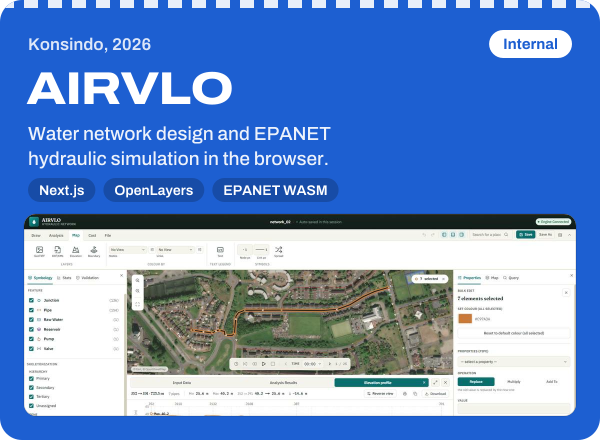
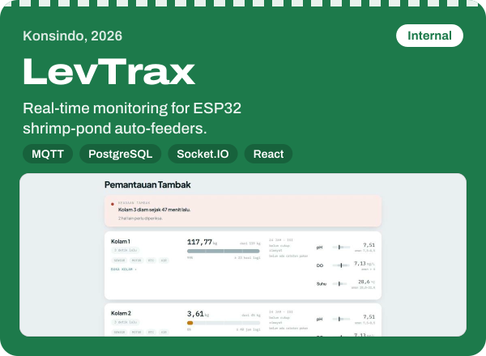
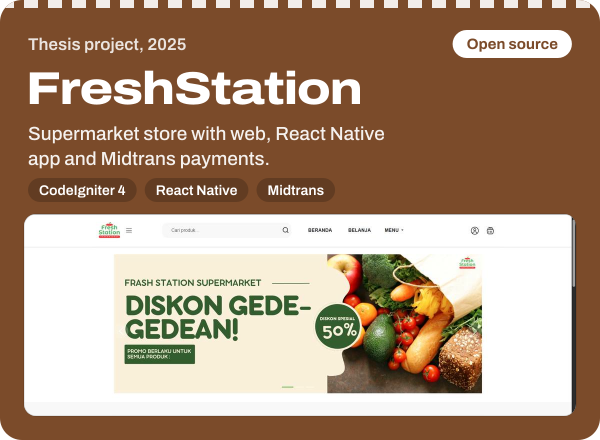
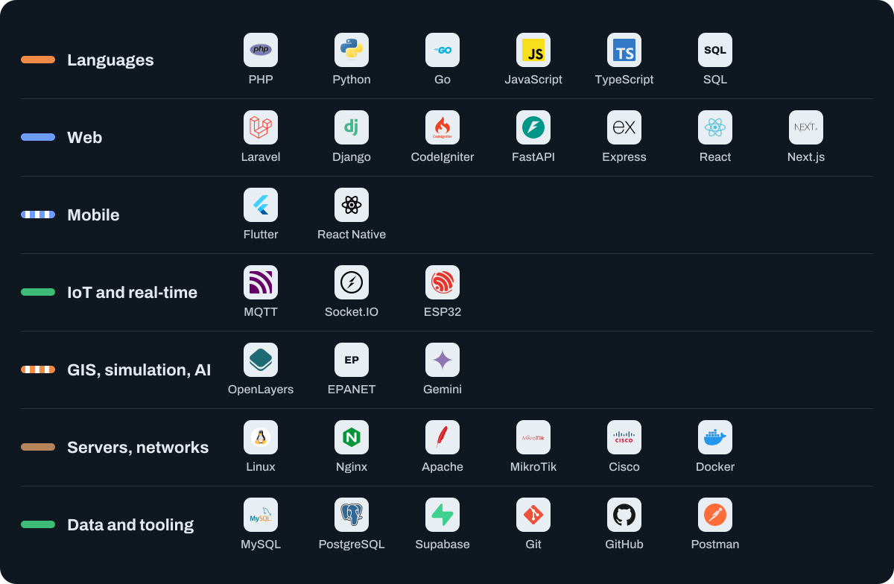

<a href="https://mury.my.id">
  <picture>
    <source media="(prefers-color-scheme: dark)" srcset="assets/banner-dark.svg">
    
  </picture>
</a>

  
  
  

I build web apps end to end, and I also run the servers and networks underneath them. I started in network engineering (CCNA, MTCNA) before moving into software, so whatever I build also gets deployed, secured and kept online. Today I'm a full-stack developer at **PT Konsindo Inovatek Utama** in Depok, Indonesia.

## Selected work

  
  

  
  

TENVIX is live at [tenvixai.com](https://tenvixai.com). AIRVLO and LevTrax are internal tools, so you'll find their screenshots on [my portfolio](https://mury.my.id/#projects) rather than their code here. More open source: [FreshStation mobile app](https://github.com/Mikusune/app_Marketplace_freshstation) (React Native), [Listrik App](https://github.com/Mikusune/Laravel-Listrik-app) (Laravel, Midtrans Snap) and a [FastAPI marketplace backend](https://github.com/Mikusune/backend_FastAPI_marketplace) (Supabase).

## Tools I use

Certified: CCNA, MTCNA, Cisco Network Security, Certified Program Analyst (BNSP), KKNI Level II Network Engineering, TOEFL Prediction 563.

## Experience

| When | Role |
|---|---|
| Apr 2026 – now | **Full-Stack Developer**, PT Konsindo Inovatek Utama. Building TENVIX, AIRVLO and LevTrax, and running their VPS, domains, databases and deployments. |
| Aug – Nov 2024 | **Software Developer (intern)**, PT Pramatech Adimitra Solusi. Led the migration of a PSAK 109 accounting system from desktop to Laravel, moved SQL Server stored procedures to PostgreSQL, and automated IRR calculations in Python. |
| Jul – Aug 2022 | **Electrical Engineering Intern**, PT Energi Sejahtera Agung. Built hardware for an earthquake early warning prototype on Raspberry Pi. |
| Sep – Dec 2021 | **Network intern**, PT Bonet Utama, an ISP. LAN setup, static routing, proxy and firewall. |

B.Sc. in Information Technology, Universitas Bina Sarana Informatika, GPA 3.96/4.00.

## Have a project in mind?

Tell me what you need built, or the server it has to run on. I work in Bahasa Indonesia and English.

  
  

Also on [Instagram](https://www.instagram.com/tmuryanto/) and [Discord](https://discord.gg/QXEn2gw).
